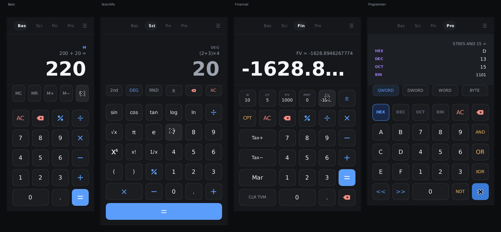
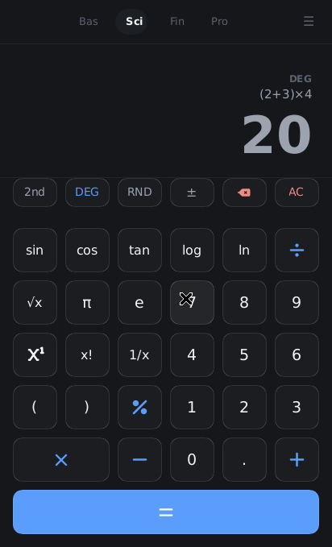

# Lion Calculator

A modern native calculator for **LionOS** built with Rust + Slint 1.17.





## Requirements

| Tool | Minimum version |
|------|----------------|
| Rust / Cargo | **1.85** (transitive deps in `Cargo.lock` use edition 2024) |
| Slint | **1.17** (fetched automatically) |
| OS | Linux (Wayland / X11), macOS, Windows |

## Build & Run

```bash
# Debug
cargo run

# Release (faster startup, smaller binary)
cargo build --release
./target/release/lion-calculator

# Start directly in a mode
./target/release/lion-calculator scientific   # or basic | financial | programmer

# Unit tests (parser, calculator state machine, TVM solver, programmer engine)
cargo test
```

## Keyboard Shortcuts

| Key | Action |
|-----|--------|
| `0`–`9`, `.` | Input digits |
| `+`, `-`, `*`, `/` | Operators |
| `%` | Percent (Basic/Fin) · modulo (Scientific) |
| `^` | Power (Scientific) |
| `(`, `)` | Parentheses (Scientific) |
| `=` or `Enter` | Evaluate (press again to repeat the last operation) |
| `Backspace` | Delete last digit / character |
| `Escape` | Close history panel, or All-clear |
| `A`–`F` | Hex digits (Programmer); `E` is Euler's constant in Scientific |
| `e` | Euler's constant (Scientific) / hex digit E (Programmer) |

## Modes

### Basic
Standard four-function calculator with a dedicated memory row
(MC / MR / M+ / M− / MS, "M" indicator in the display) and chained
operations. Percent key computes percentage of the pending value.
Pressing `=` again repeats the last operation.

### Scientific — full expression entry
Scientific mode is **expression-based**: typing builds a live formula on the
expression line (`(2+3)×4`, `2sin(30)`, `5!`, `2^10`, `√(9)`, `2π`) and the big
display shows a **dimmed live preview** of the result as you type. Press `=`
to evaluate through the recursive-descent parser (full precedence, right-
associative `^`, postfix `!`, implicit multiplication like `2π` or `3(4+1)`).

- Toolbar: **2nd** (sin→asin, cos→acos, tan→atan, log→10ˣ, ln→eˣ, √x→x²),
  **DEG/RAD** toggle, RND, ±, backspace, AC
- Trigonometry: sin / cos / tan / asin / acos / atan
- Logarithms: log₁₀, ln · Powers: xʸ, √x, x², 1/x, x!
- Constants: π, e · Extras: RND (random 0–1), `%` modulo
- Errors keep the typed expression so you can fix and retry
- History recalls an entry as an editable expression again

### Financial — TVM Solver
Enter any **4** of the 5 TVM variables (N, I/Y, PV, PMT, FV), then press
**CPT** and the target variable to solve for it using the standard ordinary
annuity formula:

```
PV·(1+i)ᴺ  +  PMT·[(1+i)ᴺ−1]/i  +  FV  =  0
```

Cash flows are signed: use **±** to toggle the sign of the entry before
storing it (e.g. PV = −1000 for an investment, PMT = −100 for a deposit).

Additional helpers:
- **Tax+** — add tax at the stored rate (default 20%)
- **Tax−** — remove tax from an inclusive total
- **Mar**  — gross margin % given cost (PV) and selling price

### Programmer
- Bases: **HEX / DEC / OCT / BIN** — live four-line conversion display
  (full-width hex literals wrap as two's complement, e.g. `FFFFFFFFFFFFFFFF` = −1)
- Bit widths: **QWORD / DWORD / WORD / BYTE** toolbar — values are re-masked
  and input is capped to what the width can hold
- Bit ops: AND, OR, XOR, NOT — and they chain left-to-right (`5 AND 3 OR 8 =`)
- Shifts: `<<`, `>>` (also chainable)
- The display area shows the pending operation (`FF AND …`) while you type
- Hex digits A–F enabled when HEX base is active
- Results are recorded in history like every other mode

## Architecture

```
lion-calculator/
├── build.rs                  Compiles the Slint UI
├── docs/                     Screenshots used by this README
├── ui/
│   ├── app_window.slint      Window, display, keyboard scope, mode tabs
│   ├── tokens.slint          LeonUX design tokens (LT global)
│   ├── basic_pad.slint       Basic pad + memory row
│   ├── scientific_pad.slint  Expression pad + 2nd/DEG toolbar
│   ├── financial_pad.slint   TVM registers, ±, tax/margin helpers
│   ├── programmer_pad.slint  Base + bit-width toolbars, bit-op pad
│   ├── history_panel.slint   Slide-over history with timestamps + Clear
│   └── …shared button components
└── src/
    ├── main.rs               Entry point (CLI mode argument)
    ├── lib.rs                Library root (native binary + wasm target)
    ├── app.rs                Slint ↔ Calculator bridge, callback wiring
    ├── calculator.rs         Unified state machine (all 4 modes)
    ├── parser.rs             Recursive-descent expression evaluator
    ├── history.rs            Bounded LIFO history store (versioned)
    ├── memory.rs             M+/M−/MR/MC/MS register
    └── modes/
        ├── financial.rs      TVM solver (multi-start Newton-Raphson), tax, margin
        └── programmer.rs     Base conversion, bit widths, bitwise ops, shift
```

## Design System (Leonux)

All colours, radii, and spacings are defined in the `LT` global in
`ui/tokens.slint`. Key tokens:

| Token | Value | Role |
|-------|-------|------|
| `LT.bg` | `#0B0D0F` | Window background |
| `LT.card` | `#15171B` | Card surface |
| `LT.btn` | `rgba(255,255,255,0.03)` | Button background |
| `LT.eq` | `#5B9DFA` | Equals button |
| `LT.t-op` | `#5B9DFA` | Operator text (blue) |
| `LT.t-dn` | `#F28B82` | Danger text (AC / DEL) |
| `LT.t-acc`| `#FAB95B` | Accent text (CPT / bitops) |
| `LT.r-btn`| `12px` | Button corner radius |
